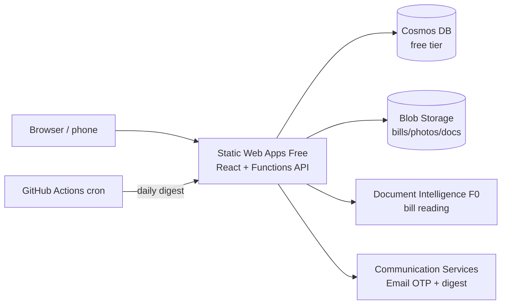

# Anantam Ventures — construction management

A web app for running an apartment construction business: bills and expenses (read by AI), vendors, budgets, flat sales and
customer payment schedules, follow-ups, site progress and photos, materials, labour and wages, a document vault, users and an audit log.

## Features

| Area | What you get |
|---|---|
| **Login** | Username **or** email → 6-digit code emailed (10 min, single use, 5 attempts, 3 sends / 15 min). HttpOnly session cookie (12 h). |
| **Bills & expenses** | Upload PDF/photo → **Azure AI Document Intelligence** reads vendor, bill #, dates, subtotal, GST, total → auto category (vendor default → keyword rules) → bill created as *Needs review*. Duplicate detection. Paid / Partially paid / Unpaid tracking, payment mode, "Mark paid". Vendors learn their default category. |
| **Vendors & contractors** | Contact, GSTIN, bank/UPI, default category. |
| **Budgets** | Budget per category / phase; dashboard shows budget vs actual with overruns highlighted. |
| **Flats & bookings** | Unit inventory (block, floor, type, area, price, status). Booking auto-sets flat to Booked / Sold / Available. |
| **Customer payment schedule** | Construction-linked stages, due dates, receipts, receivables & overdue tracking. |
| **Follow-ups & tasks** | Assignee, due date, priority, status. |
| **Site** | Milestones with % complete, site photo log (camera capture on phones), material stock in/out with low-stock alerts, labour register, attendance, monthly wage report (OT + advances). |
| **Document vault** | Approvals, agreements, NOCs with expiry alerts. |
| **Dashboard** | Spend, unpaid/overdue bills, receivables, progress, wages, spend by category/phase/month, alerts. |
| **Daily digest email** | 09:00 IST: bills/customer payments due in 3 days, overdue tasks, expiring documents — per role. |
| **Admin** | Users & roles, audit log (400-day retention), CSV export everywhere. |

Roles: **admin** (everything), **accountant** (finance + sales), **engineer** (site, bills upload, tasks), **viewer** (read-only).

## Architecture



- `web/` — React 19 + Vite + TypeScript. Screens are generated from the API's entity schema (`GET /api/schema`).
- `api/` — Azure Functions v4 (Node/TypeScript). Entity definitions, validation and roles live in `api/src/schema.ts`.
- `infra/` — Bicep + `deploy.sh`.

## Cost (target ≈ $0–2 / month, hard ceiling $150)

| Resource | Tier | Expected monthly cost |
|---|---|---|
| Static Web Apps (site + API) | Free | $0 |
| Cosmos DB | Free tier, **capped at 1000 RU/s** (`totalThroughputLimit`) | $0 |
| Blob Storage | Standard LRS, private | < $0.10 for a few GB |
| Document Intelligence | F0 (500 pages / month free, first 2 pages per bill) | $0 |
| Communication Services Email | Pay-per-use (~$0.00025 / email) | < $0.05 |
| GitHub Actions (CI, deploy, cron) | Public repo | $0 |

Guard-rails: subscription budget ($20 default) with 50/80/100 % and forecast alerts, Cosmos throughput cap,
`deploy.sh` refuses to run against any subscription other than `240b9dac-…` or to create a second (paid) Cosmos account,
and the Visual Studio subscription's spending limit stops all charges at the $150 credit.
**If you exceed 500 bill pages/month**, Document Intelligence F0 returns errors (no charge); bills are still saved for manual entry.

## Local development

```bash
cd api && cp local.settings.sample.json local.settings.json   # set BOOTSTRAP_ADMIN_EMAIL
npm install && npm start                                       # Functions on :7071 (needs Azure Functions Core Tools)
cd ../web && npm install && npm run dev                        # http://localhost:5173
```

Without Azure settings the API runs fully offline: data in `api/.data/db.json`, files in `api/.data/files`,
emails (including OTP codes) written to `api/.data/dev-mail.log`, AI parsing skipped.

Tests: `cd api && npm test`.

## Deploy (when you're ready)

```bash
az login
ADMIN_EMAIL=you@example.com ./infra/deploy.sh
```

Then add the three repo secrets it prints (`AZURE_STATIC_WEB_APPS_API_TOKEN`, `APP_URL`, `JOB_KEY`) and push to `main`.
Sign in with `ADMIN_EMAIL`, then add other users under **Admin → Users**.
