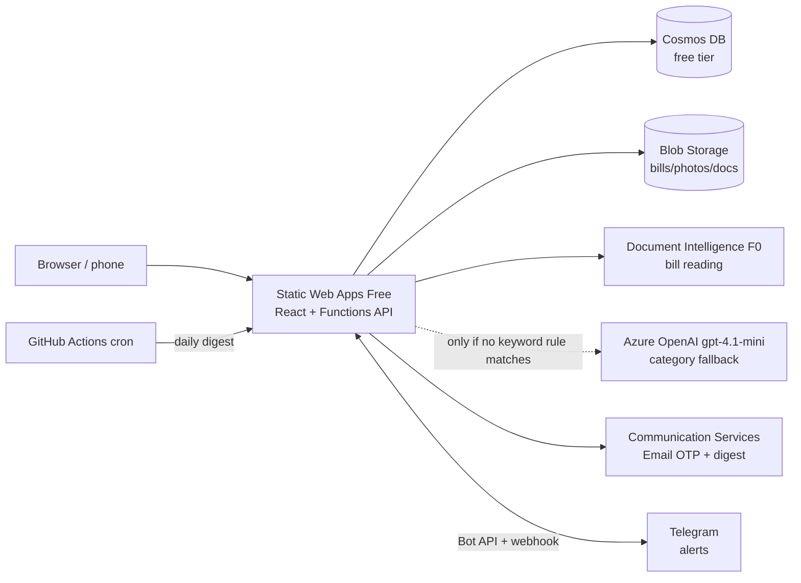

# Anantam Ventures — construction management

A web app for running an apartment construction business: bills and expenses (read by AI), vendors, budgets, flat sales and
customer payment schedules, follow-ups, site progress and photos, materials, labour and wages, a document vault, users and an audit log.

## Features

| Area | What you get |
|---|---|
| **Projects** | Run several sites at once. After login you pick a project (admins see **+ New project**); a switcher in the header changes project. Every record, report, CSV export and file belongs to one project; the daily digest groups items by project. Admins see all projects, other users only those they're a member of (enforced in the API on every read, write and file download). |
| **Project share link** | Each project has **one** public, unguessable link (`/u/<token>`, 192-bit) to share on WhatsApp — no account needed. It offers two choices: **Upload a bill** (photo/PDF, max 10 MB: we read it with AI, the guest confirms **Whom to pay** — pre-filled from the bill — adds remarks, name, phone and optional email, and a payment request is raised) or **Request a payment** (see below). Submissions land in that project as *Needs review* (**Guest** / **Pay request** badge). Admins copy, disable/enable or create a new link from **Projects** (a new link kills the old one immediately). Older `/pay/<token>` links open the same page on *Request a payment* and keep working until a new link is created. Abuse limits: 5 uploads / 10 min per IP, 20 / hour per link, magic-byte file check; bad and disabled links look identical. The bill is read once (a short-lived draft holds the result while the guest confirms), so Document Intelligence pages are not spent twice. |
| **Request a payment** | For pay requests that used to arrive on WhatsApp. Mobile-first form: **Whom to pay**, amount ₹, purpose, mode of payment — **UPI** (mobile number or UPI ID), **QR code** (image upload), **Bank account** (holder, account # entered twice, IFSC, bank) or **Cash** — and optional requester name/phone/email. Formats are validated (10-digit mobile / UPI ID, IFSC, 9–18 digit account). It becomes an **Unpaid** bill (*Needs review*, **Pay request** badge, auto category) with the payee's details. |
| **Login** | Username **or** email → 6-digit code emailed (10 min, single use, 5 attempts, 3 sends / 15 min). HttpOnly session cookie (12 h). |
| **Bills & expenses** | **Needs review** filter with count. Upload PDF/photo → **Azure AI Document Intelligence** reads vendor, bill #, dates, subtotal, GST, total → auto category (vendor default → keyword rules → **Azure OpenAI gpt-4.1-mini** fallback only when no rule matches; also suggests a phase) → bill created as *Needs review*. Duplicate detection. **Unpaid / Paid / All tabs** (default Unpaid, which includes Partially Paid) with count and ₹ total/balance due; **Mark paid** records amount, date, mode and reference, supports **partial payments** (balance shown) and keeps a payment history. Dashboard shows Unpaid vs Paid and pending payment requests. Vendors learn their default category. **+ Payment request** on the Bills page lets members raise the same payment request themselves (Unpaid, no review flag, auto category). Every bill — new or existing — has an optional **How to pay this vendor** section (UPI / QR / bank / cash, same validation; QR can be uploaded or replaced) and shows copy buttons, the QR and *Open in UPI app* whenever details exist; a new bill for a known vendor pre-fills the details from that vendor's latest bill. **Whom to pay** is required on every new bill (older bills show the vendor name). Every bill row has a **View** button opening `/bills/<id>`: for unpaid bills a prominent **How to pay** panel at the top (big UPI number/ID with Copy and *Open in UPI app*, large tap-to-zoom QR, bank details with copy buttons, or a cash note) next to **Mark as paid**; then amount/paid/balance, details, remarks, submitter, payment history and the attached bill file (inline image/PDF preview + **Open original**, attach or replace). Files are only served to project members through the authenticated `/api/files/…` endpoint. |
| **Vendors & contractors** | Contact, GSTIN, bank/UPI, default category. |
| **Budgets** | Budget per category / phase; dashboard shows budget vs actual with overruns highlighted. |
| **Flats & bookings** | Unit inventory (block, floor, type, area, price, status). Booking auto-sets flat to Booked / Sold / Available. |
| **Customer payment schedule** | Construction-linked stages, due dates, receipts, receivables & overdue tracking. |
| **Follow-ups & tasks** | Assignee, due date, priority, status. |
| **Site** | Milestones with % complete, site photo log (camera capture on phones), material stock in/out with low-stock alerts, labour register, attendance, monthly wage report (OT + advances). |
| **Document vault** | Approvals, agreements, NOCs with expiry alerts. |
| **Dashboard** | Spend, unpaid/overdue bills, receivables, progress, wages, spend by category/phase/month, alerts. |
| **Daily digest email** | 09:00 IST: bills/customer payments due in 3 days, overdue tasks, expiring documents — per role. |
| **Telegram alerts** | Free, opt-in per person. Under **Notifications** each user connects Telegram and ticks, per project they can access: payment requests, guest bill uploads, bills added by the team, bills paid/part-paid and the daily digest. Admins get payment requests + guest uploads by default. Messages are short (project, payee/vendor, ₹, purpose, mode, link) and never include full account numbers or QR images. You never get alerts for your own changes. |
| **Bill status emails** | When a bill's status changes (Unpaid ⇄ Partially Paid ⇄ Paid), the requestor gets an email: the team member who added it (toggle under **Notifications**, on by default; includes a link to the bill), or a guest / payment-request submitter who gave the optional email (no app link). Shows project, payee, amount, paid, balance, paid date, mode, reference/UTR and their remarks; account numbers show only the last 4 digits. Never sent for your own change; one-click unsubscribe in every email; max 20 per bill and 10 per address per hour. Uses the existing Communication Services sender. |
| **Admin** | Users & roles, audit log (400-day retention), CSV export everywhere. |
| **Design ("Formwork")** | Drawing-sheet look: concrete/sheet palette, safety-yellow single primary action per view, square edges and 1–2px rules, title block (project · sheet · date), tabular Indian-grouped money. Status tags use colour **and** a second cue: solid orange UNPAID, hatched PART bar showing the balance, green-outline ✓ PAID, blue revision cloud for AI bills needing review. Bills list shortcuts: **U / P / A** tabs, **/** search, **↑/↓** + **Enter** open. **Mark as paid** is a 3-step stepper (Amount → Mode → Reference/UTR; Enter accepts defaults). Fonts: self-hosted subsets of Archivo and JetBrains Mono (SIL OFL, `web/public/fonts/`). |

Roles: **admin** (everything), **accountant** (finance + sales), **engineer** (site, bills upload, tasks), **viewer** (read-only).

## Architecture



- `web/` — React 19 + Vite + TypeScript. Screens are generated from the API's entity schema (`GET /api/schema`).
- `api/` — Azure Functions v4 (Node/TypeScript). Entity definitions, validation and roles live in `api/src/schema.ts`.
- `infra/` — Bicep + `deploy.sh`.
- **Projects:** `project` docs (name, location, status, start date, notes, `members`, `shareToken`, `shareEnabled`) are managed via `/api/projects`.
  All other entities except users and the audit log carry a `projectId`; the web app sends `?project=<id>` and the API checks
  membership (`api/src/projects.ts`). New files are stored under `p/<projectId>/…` so downloads are checked against the project.
  On first start after the upgrade, existing data is moved into a **Default project** (idempotent; existing non-admin users become members).
  Same Cosmos container and partition key (`/type`) — no extra cost.
- **Project share link:** `GET /api/public/projects/{token}`, `POST /api/public/upload/{token}/read` (store + AI-read the file → `draft`) then `POST /api/public/upload/{token}` (`draft`, `payee`, remarks, name…; a one-step `file` form still works) (no login, `api/src/functions/guest.ts`); the share token and a legacy pay token are both accepted;
- **Payment requests:** `GET`/`POST /api/public/pay/{token}` (no login, `api/src/functions/payrequest.ts`); members raise one with `POST /api/bills/payment-request` (same multipart form); any bill's `payTo` (`{mode, upi | qrFile | accountHolder, accountNumber, ifsc, bankName}`, or `null`) can be set on `POST`/`PUT /api/entities/bill`; payments are recorded with `POST /api/bills/{id}/payment`;
  rate-limit counters are short-lived Cosmos docs with TTL.

## Cost (target ≈ $0–2 / month, hard ceiling $150)

| Resource | Tier | Expected monthly cost |
|---|---|---|
| Static Web Apps (site + API) | Free | $0 |
| Cosmos DB | Free tier, **capped at 1000 RU/s** (`totalThroughputLimit`) | $0 |
| Blob Storage | Standard LRS, private | < $0.10 for a few GB |
| Document Intelligence | F0 (500 pages / month free, first 2 pages per bill) | $0 |
| Communication Services Email | Pay-per-use (~$0.00025 / email) | < $0.05 |
| Azure OpenAI (gpt-4.1-mini, South India, GlobalStandard 10K TPM) | Pay-per-token, S0 has no fixed fee; only called when keyword rules don't match (~600 tokens ≈ $0.0003 / call) | < $0.50 (≈ ₹40) even at 1,000 such bills |
| GitHub Actions (CI, deploy, cron) | Public repo | $0 |
| Telegram Bot API | Free | $0 |

Guard-rails: subscription budget ($20 default) with 50/80/100 % and forecast alerts, Cosmos throughput cap,
`deploy.sh` refuses to run against any subscription other than `240b9dac-…` or to create a second (paid) Cosmos account,
and the Visual Studio subscription's spending limit stops all charges at the $150 credit.
**If you exceed 500 bill pages/month**, Document Intelligence F0 returns errors (no charge); bills are still saved for manual entry.
The OpenAI fallback is fail-safe: if `AZURE_OPENAI_*` settings are missing, the call errors or takes over 10 s, or the answer
isn't a known category, the bill is simply categorised *Miscellaneous*. The 10K tokens/min capacity also limits worst-case spend.
The public guest and payment-request links are rate-limited (per IP and per link) so it can't burn the Document Intelligence free quota or OpenAI tokens;
an admin can disable or regenerate a leaked link instantly.

## Local development

```bash
cd api && cp local.settings.sample.json local.settings.json   # set BOOTSTRAP_ADMIN_EMAIL
npm install && npm start                                       # Functions on :7071 (needs Azure Functions Core Tools)
cd ../web && npm install && npm run dev                        # http://localhost:5173
```

Without Azure settings the API runs fully offline: data in `api/.data/db.json`, files in `api/.data/files`,
emails (including OTP codes) written to `api/.data/dev-mail.log`, AI parsing and the OpenAI category fallback skipped.

Telegram alerts stay off locally unless you set `TELEGRAM_BOT_TOKEN` and `TELEGRAM_WEBHOOK_SECRET`.

Tests: `cd api && npm test`.

## Deploy (when you're ready)

```bash
az login
ADMIN_EMAIL=you@example.com ./infra/deploy.sh
```

Then add the three repo secrets it prints (`AZURE_STATIC_WEB_APPS_API_TOKEN`, `APP_URL`, `JOB_KEY`) and push to `main`.
Sign in with `ADMIN_EMAIL`, then add other users under **Admin → Users**.

`deploy.sh` is safe to rerun: it reuses the existing `JWT_SECRET`, `JOB_KEY`, `TELEGRAM_WEBHOOK_SECRET` and `TELEGRAM_BOT_TOKEN`
from the Static Web App instead of regenerating or dropping them.
To add only the OpenAI fallback to an existing deployment, deploy `infra/openai.bicep` and merge its three
`AZURE_OPENAI_*` settings with `az staticwebapp appsettings set` (that command merges settings, it doesn't replace them).

### Telegram notifications (one-time setup)

Until both settings below exist the feature is inert and the Notifications page says *Telegram not configured yet*.

1. In Telegram, open **@BotFather**, send `/newbot`, pick a name and a username ending in `bot`. Copy the token it gives you.
2. Merge the two settings into the Static Web App (`appsettings set` merges; never paste the token anywhere else):
   ```bash
   SWA=$(az staticwebapp list -g anantam-rg --query "[0].name" -o tsv)
   read -rs TOKEN   # paste the BotFather token, press Enter
   az staticwebapp appsettings set -n "$SWA" -g anantam-rg -o none \
     --setting-names TELEGRAM_BOT_TOKEN="$TOKEN" TELEGRAM_WEBHOOK_SECRET="$(openssl rand -hex 32)"
   ```
   (If `TELEGRAM_WEBHOOK_SECRET` already exists, for example from `deploy.sh`, set only the token.)
3. Sign in as an admin and open **Notifications**. The webhook is registered automatically on that first visit
   (`setWebhook` to `https://www.anantamventures.com/api/telegram/webhook` with the secret); **Register webhook** forces it again.
4. Each person taps **Connect Telegram** → **Start** in the bot chat, then ticks what they want. `/stop` in the chat or
   **Disconnect** in the app unlinks. Connect links work once and expire after 15 minutes.

If you rotate the token or the secret, an admin just opens Notifications again (or presses **Register webhook**).
